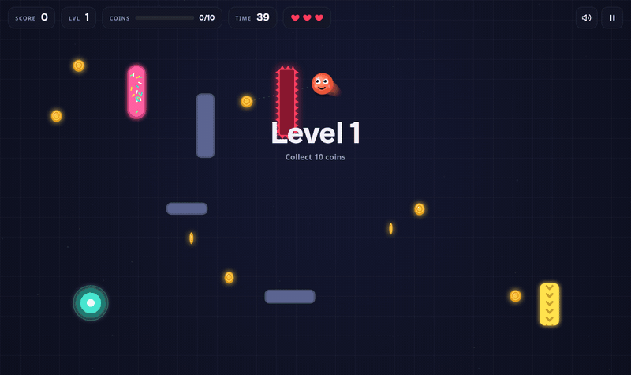
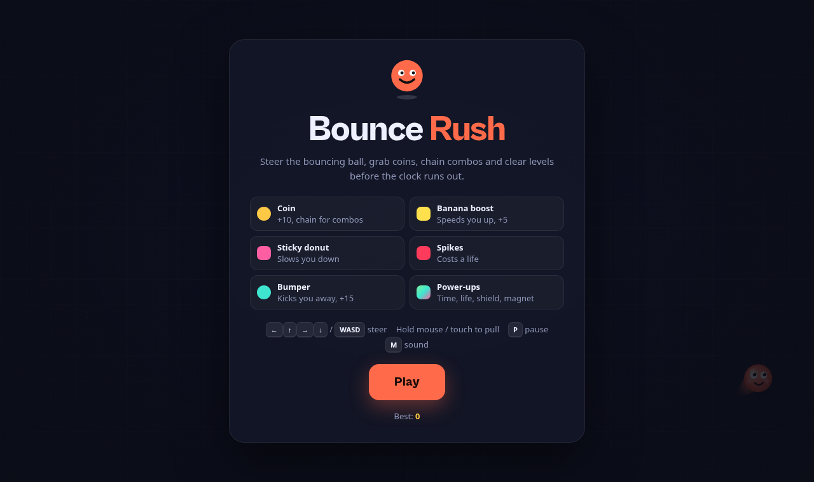
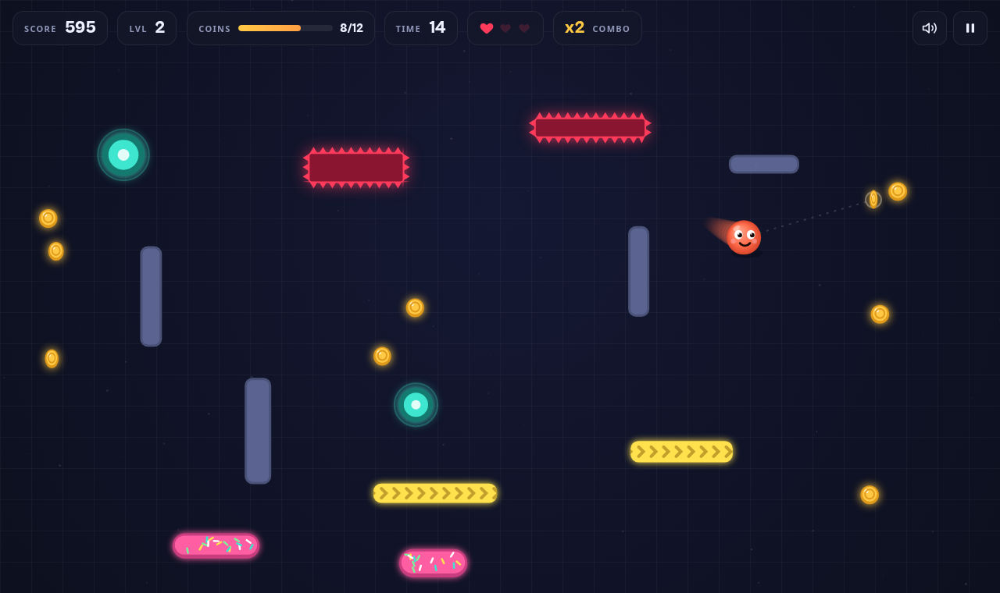
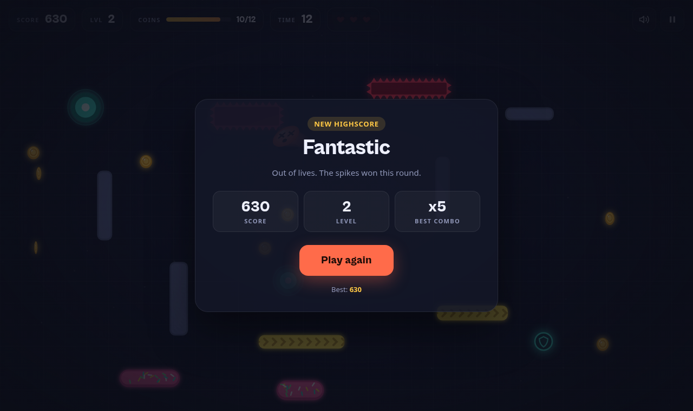
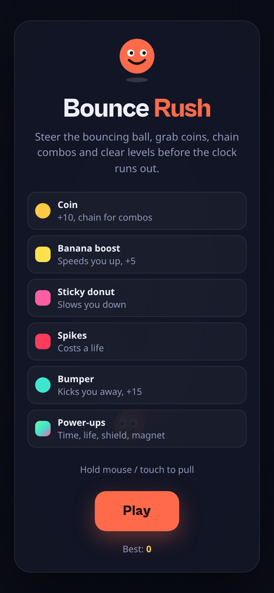
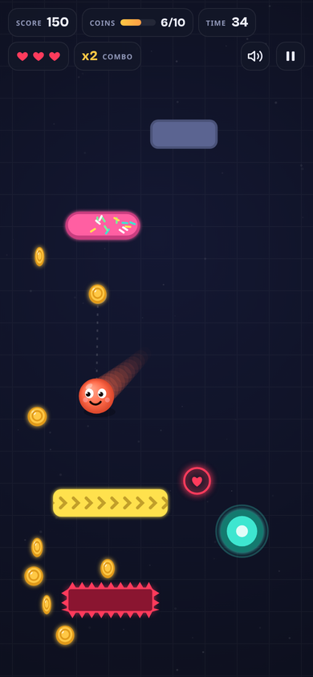

<div align="center">


# Bounce Rush

**Ein schneller Arcade-Bouncer im Browser. Steuere den Ball, sammle Münzen, bau Combos – bevor die Zeit abläuft.**




</div>

---

## Überblick

Bounce Rush ist ein komplettes Spiel in **einer einzigen HTML-Datei** – ohne Build, ohne Framework, ohne Server. Datei öffnen, spielen.

- Physik mit festem Zeitschritt (120 Hz) – läuft auf 60-Hz- und 144-Hz-Bildschirmen gleich schnell
- Ball mit Gesicht, Squash-&-Stretch, Schweif und Partikeleffekten
- Synthetisierte Soundeffekte über die Web Audio API (keine Audiodateien)
- Level-System mit steigender Schwierigkeit und beweglichen Hindernissen
- Combos, Power-ups, Bumper und Highscore im `localStorage`
- Desktop (Tastatur/Maus) und Mobil (Touch), HiDPI-scharf

## Schnellstart

1. [`index.html` herunterladen](../../raw/main/index.html) (oder das Repo klonen)
2. Datei im Browser öffnen – fertig.

Keine Installation, kein Server, keine Abhängigkeiten.

## Spielanleitung

### Ziel

Sammle in jedem Level die geforderte Anzahl **Münzen**, bevor die Zeit abläuft. Jedes geschaffte Level bringt **+15 Sekunden** und einen Zeitbonus auf den Punktestand (5 Punkte je Restsekunde). Das Spiel endet, wenn die Zeit abläuft oder alle Leben verloren sind.

### Steuerung

| Aktion | Desktop | Mobil |
|---|---|---|
| Ball lenken | <kbd>←</kbd> <kbd>↑</kbd> <kbd>→</kbd> <kbd>↓</kbd> oder <kbd>W</kbd> <kbd>A</kbd> <kbd>S</kbd> <kbd>D</kbd> (gedrückt halten) | – |
| Ball zum Zeiger ziehen | Maustaste gedrückt halten | Finger auf dem Bildschirm halten |
| Start / Pause | <kbd>Leertaste</kbd>, <kbd>Enter</kbd>, <kbd>P</kbd>, <kbd>Esc</kbd> | Pause-Button |
| Ton an/aus | <kbd>M</kbd> | Lautsprecher-Button |

Der Ball fliegt von selbst. Lenken beschleunigt ihn in die gewünschte Richtung; lässt du los, pendelt er sich auf Reisegeschwindigkeit ein.

### Spielelemente

| Element | Aussehen | Wirkung |
|---|---|---|
| **Münze** | goldene, drehende Münze | +10 Punkte × Combo |
| **Wand** | graublauer Block | normaler Abprall |
| **Bananen-Boost** | gelb mit Pfeilen | beschleunigt den Ball, +5 Punkte |
| **Klebriger Donut** | pink mit Streuseln | bremst den Ball ab |
| **Stacheln** | roter Block mit Zacken | **kostet ein Leben** |
| **Bumper** | türkiser Ring | schleudert den Ball weg, +15 Punkte |

### Combos

Sammelst du Münzen innerhalb von **1,7 Sekunden** hintereinander, steigt der Multiplikator – bis maximal **×6**. Ein Stachel-Treffer setzt die Combo zurück.

### Power-ups

Erscheinen alle 7–12 Sekunden und verschwinden nach 8 Sekunden (sie blinken kurz vorher).

| Power-up | Wirkung |
|---|---|
| Uhr | +5 Sekunden |
| Herz | +1 Leben (max. 5) |
| Schild | blockt den nächsten Stachel-Treffer |
| Magnet | zieht 7 Sekunden lang Münzen in der Nähe an |

### Schwierigkeit

Mit jedem Level steigen Anzahl der Hindernisse, Stacheln und Bumper sowie die benötigten Münzen (8 + 2 × Level). Ab Level 3 beginnen einzelne Hindernisse, sich zu bewegen.

## Screenshots

<table>
  <tr>
    <td width="50%"><br><sub><b>Startbildschirm</b> mit Legende und Steuerung</sub></td>
    <td width="50%"><br><sub><b>Gameplay</b> – Level 2 mit Combo</sub></td>
  </tr>
  <tr>
    <td width="50%"><br><sub><b>Rundenende</b> mit Statistik und Highscore</sub></td>
    <td width="50%" align="center">
      
      <br>
      <sub><b>Mobil</b> – Touch-Steuerung</sub>
    </td>
  </tr>
</table>

## Technik

| Bereich | Umsetzung |
|---|---|
| Rendering | Canvas 2D, HiDPI (`devicePixelRatio`, max. 2), vorgerenderter Hintergrund |
| Game Loop | `requestAnimationFrame` + Akkumulator mit festem Zeitschritt 1/120 s |
| Kollision | Kreis-gegen-Rechteck mit Eindringtiefen-Korrektur und Reflexion an der Normalen; Kreis-gegen-Kreis für Bumper |
| Audio | Web Audio API, Oszillatoren mit Hüllkurven |
| UI | DOM-Overlay (HUD, Menüs) über dem Canvas |
| Speicher | `localStorage` für Highscore und Ton-Einstellung (mit Fallback) |
| Schriften | Cabinet Grotesk & Satoshi (Fontshare), System-Fallback offline |

### Test-Hooks

Für automatisierte Tests (z. B. Playwright) stellt das Spiel zwei globale Funktionen bereit:

```js
window.advanceTime(ms)        // Spiel deterministisch um ms weiterrechnen und rendern
window.render_game_to_text()  // aktueller Spielzustand als JSON-String
```

### Projektstruktur

```
bounce-rush/
├── index.html          # das komplette Spiel
├── docs/
│   ├── logo.svg
│   ├── preview.gif
│   └── screenshots/
├── LICENSE
└── README.md
```

## Lizenz

**Proprietär – alle Rechte vorbehalten.** © 2026 Michael Grüb.

Der Quellcode und alle Inhalte sind Eigentum des Autors. Jede Nutzung, Vervielfältigung, Veränderung oder Weitergabe ohne ausdrückliche schriftliche Genehmigung ist untersagt. Details siehe [LICENSE](LICENSE).
